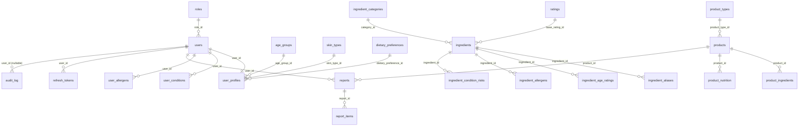

# ScanWise — Project Analysis & Database Development Plan

## Project Status Summary

| Area | Status | Notes |
|---|---|---|
| **Documentation** | ✅ Strong | PRDv1/v2, TRDv1/v2, SRDv1 all exist — well-documented |
| **Database Schema** | ✅ Written | [schema.sql](file:///c:/Users/SAHIL/Desktop/ScanWise/db/schema.sql) — 653 lines of production-grade T-SQL |
| **Sample Queries** | ✅ Written | [queries.sql](file:///c:/Users/SAHIL/Desktop/ScanWise/db/queries.sql) — 16 query blocks covering all operations |
| **Seed Data** | ❌ Empty | [ingredients_seed.csv](file:///c:/Users/SAHIL/Desktop/ScanWise/db/seed/ingredients_seed.csv) and [load_seed.py](file:///c:/Users/SAHIL/Desktop/ScanWise/db/seed/load_seed.py) are blank |
| **Backend Code** | ❌ Empty shell | All `.py` files in [backend/app/](file:///c:/Users/SAHIL/Desktop/ScanWise/backend/app) are blank — structure exists, no code |
| **Frontend Code** | ❌ Empty shell | Structure exists under [frontend/src/](file:///c:/Users/SAHIL/Desktop/ScanWise/frontend/src), no implementation |
| **OpenAPI Spec** | ❌ Empty | [openapi.yaml](file:///c:/Users/SAHIL/Desktop/ScanWise/openapi.yaml) is blank |
| **Requirements.txt** | ❌ Empty | [requirements.txt](file:///c:/Users/SAHIL/Desktop/ScanWise/backend/requirements.txt) is blank |

> [!IMPORTANT]
> You have excellent documentation and a detailed T-SQL schema. The gap is that **zero lines of actual code** exist. The database is the correct first step — everything (backend, analysis, reports) depends on it.

---

## Your Database at a Glance

Your [schema.sql](file:///c:/Users/SAHIL/Desktop/ScanWise/db/schema.sql) defines **22 tables**, grouped into 6 logical domains:



### Table Groups

| Group | Tables | Purpose |
|---|---|---|
| **Lookups** (9 tables) | `roles`, `age_groups`, `ratings`, `product_types`, `ingredient_categories`, `nutrients`, `health_conditions`, `allergens`, `skin_types`, `dietary_preferences` | Reference data, seeded once |
| **Users** (4 tables) | `users`, `user_profiles`, `user_conditions`, `user_allergens` | User accounts and personalization preferences |
| **Ingredients** (5 tables) | `ingredients`, `ingredient_aliases`, `ingredient_age_ratings`, `ingredient_allergens`, `ingredient_condition_risks` | The knowledge base that powers analysis |
| **Products** (3 tables) | `products`, `product_ingredients`, `product_nutrition` | Scanned product fingerprints |
| **Reports** (2 tables) | `reports`, `report_items` | Personalized scan result snapshots |
| **Operations** (4 tables) | `otp_requests`, `refresh_tokens`, `audit_log`, `scan_events`, `stg_ingredient_seed` | Auth, logging, analytics, staging |

---

## Step-by-Step Database Development Plan

### Step 1: Set Up Azure SQL Database

> [!NOTE]
> If you haven't already created the Azure SQL resource, do this first.

1. **Create the Azure SQL Server** on the Azure Portal
   - Choose your region (Central India if available on student plan)
   - Set authentication to "SQL authentication" — create an admin username/password
   - Note down: `server-name.database.windows.net`, admin username, admin password

2. **Create a database** on that server
   - Name: `scanwise_dev` (or `ScanWise`)
   - Pricing tier: **Free tier** or **Basic** (₹0 for student plan)
   - Collation: leave default (`SQL_Latin1_General_CP1_CI_AS`)

3. **Configure the firewall**
   - Go to Server → Networking → Add your current client IP
   - Also add "Allow Azure services" if you'll deploy the backend on Azure later

---

### Step 2: Install Local Tools

You'll need these on your Windows machine:

```powershell
# 1. Install ODBC Driver 18 for SQL Server (if not already installed)
#    Download from: https://learn.microsoft.com/en-us/sql/connect/odbc/download-odbc-driver-for-sql-server
#    Or use winget:
winget install Microsoft.ODBCDriver18

# 2. Install Azure Data Studio or use SSMS
#    Azure Data Studio (lightweight, recommended):
winget install Microsoft.AzureDataStudio

# 3. Verify the driver is installed
#    Open PowerShell and run:
Get-OdbcDriver | Where-Object { $_.Name -like "*SQL Server*" }
```

> [!TIP]
> Azure Data Studio is lighter than SSMS and works perfectly for running your schema and queries. Use whichever you prefer.

---

### Step 3: Run the Schema

1. **Connect** Azure Data Studio (or SSMS) to your Azure SQL server
   - Server: `your-server.database.windows.net`
   - Authentication: SQL Login
   - User/Password: your admin credentials
   - Database: `scanwise_dev`

2. **Run [schema.sql](file:///c:/Users/SAHIL/Desktop/ScanWise/db/schema.sql) in its entirety**
   - Open the file → Execute
   - The `GO` batch separators work in Azure Data Studio / SSMS
   - This creates all 22 tables, indexes, the trigger, the stored procedure, analytics views, roles, and lookup seed data

3. **Verify the result** — run these checks after execution:

```sql
-- Check all tables were created
SELECT TABLE_SCHEMA, TABLE_NAME 
FROM INFORMATION_SCHEMA.TABLES 
WHERE TABLE_TYPE = 'BASE TABLE'
ORDER BY TABLE_SCHEMA, TABLE_NAME;

-- Check lookup data was seeded
SELECT * FROM dbo.roles;
SELECT * FROM dbo.age_groups;
SELECT * FROM dbo.ratings;
SELECT * FROM dbo.product_types;
SELECT * FROM dbo.ingredient_categories;
SELECT * FROM dbo.nutrients;
SELECT * FROM dbo.health_conditions;
SELECT * FROM dbo.allergens;
SELECT * FROM dbo.skin_types;
SELECT * FROM dbo.dietary_preferences;

-- Check the stored procedure exists
SELECT ROUTINE_NAME FROM INFORMATION_SCHEMA.ROUTINES 
WHERE ROUTINE_TYPE = 'PROCEDURE';

-- Check the trigger exists
SELECT name FROM sys.triggers WHERE parent_id = OBJECT_ID('dbo.ingredients');

-- Check the analytics views
SELECT TABLE_NAME FROM INFORMATION_SCHEMA.VIEWS 
WHERE TABLE_SCHEMA = 'analytics';
```

> [!CAUTION]
> Run this on an **empty** database only. If tables already exist, you'll get creation errors. Drop them first or use a fresh database.

---

### Step 4: Verify the Schema with Test Data

Insert a few test rows to make sure relationships, constraints, and the trigger work:

```sql
-- 1. Create a test user
INSERT INTO dbo.users (phone_number, consented_at)
VALUES (N'+919999900001', SYSUTCDATETIME());
-- user_id = 1 (IDENTITY)

-- 2. Create their profile
INSERT INTO dbo.user_profiles (user_id, age_group_id)
VALUES (1, 3);  -- adult

-- 3. Add a health condition
INSERT INTO dbo.user_conditions (user_id, condition_id)
VALUES (1, (SELECT condition_id FROM dbo.health_conditions WHERE code = 'diabetes'));

-- 4. Add an allergen
INSERT INTO dbo.user_allergens (user_id, allergen_id)
VALUES (1, (SELECT allergen_id FROM dbo.allergens WHERE code = 'peanut'));

-- 5. Add a test ingredient
INSERT INTO dbo.ingredients (name, normalized_name, category_id, uses, disadvantages, base_rating_id, source, is_reviewed)
VALUES (
    N'Sugar', N'sugar',
    (SELECT category_id FROM dbo.ingredient_categories WHERE code = 'sweetener'),
    N'Adds sweetness and flavour',
    N'High consumption linked to obesity, diabetes, tooth decay',
    2,  -- adjustable
    'seed', 1
);

-- 6. Verify the ingredient
SELECT * FROM dbo.ingredients WHERE normalized_name = 'sugar';

-- 7. Test the trigger — update the ingredient and check audit_log
UPDATE dbo.ingredients SET base_rating_id = 3 WHERE normalized_name = 'sugar';
SELECT TOP 5 * FROM dbo.audit_log ORDER BY audit_id DESC;

-- 8. Clean up test data (optional)
-- DELETE FROM dbo.users WHERE user_id = 1;  -- CASCADE deletes profile, conditions, allergens
-- DELETE FROM dbo.ingredients WHERE normalized_name = 'sugar';
```

---

### Step 5: Test the Stored Procedure

This tests the transactional save — the most complex database operation in your system:

```sql
-- First, make sure you have a user (user_id = 1) and at least one ingredient
-- Then run the sp_save_report test from queries.sql (query block #7)

DECLARE @new_public_id UNIQUEIDENTIFIER;

EXEC dbo.sp_save_report
     @user_id                  = 1,
     @product_hash             = '0000000000000000000000000000000000000000000000000000000000000001',
     @product_type_code        = 'food',
     @label_name               = N'Test biscuit',
     @serving_size             = 30,
     @serving_unit             = 'g',
     @product_ingredients_json = N'[{"ingredient_id":1,"position":1}]',
     @nutrition_json           = N'[{"nutrient_code":"sugar","amount":9.5}]',
     @user_product_name        = N'My test biscuit',
     @age_group_code           = 'adult',
     @verdict                  = 'okay',
     @overall_score            = 62,
     @max_servings_per_day     = 2.0,
     @days_per_week            = 4,
     @guidance_basis           = 'rule',
     @items_json               = N'[{"ingredient_id":1,"rating_code":"adjustable","reason":"High sugar"}]',
     @public_id                = @new_public_id OUTPUT;

SELECT @new_public_id AS saved_report_public_id;

-- Verify
SELECT * FROM dbo.products;
SELECT * FROM dbo.product_ingredients;
SELECT * FROM dbo.product_nutrition;
SELECT * FROM dbo.reports;
SELECT * FROM dbo.report_items;
SELECT * FROM dbo.audit_log ORDER BY audit_id DESC;
```

---

### Step 6: Test the Sample Queries

Run each query block from [queries.sql](file:///c:/Users/SAHIL/Desktop/ScanWise/db/queries.sql) one at a time. These are your **future backend queries** — confirming they work now saves debugging later.

Key queries to verify:

| Query # | What it tests | Why it matters |
|---|---|---|
| **1** | Ingredient matching (name + alias) | Core of the scan pipeline |
| **2** | Unknown ingredient detection | Decides what goes to Gemini |
| **3** | Product hash reuse | The caching strategy |
| **4** | Personalised ratings (logged-in user) | The analysis engine |
| **5** | Personalised ratings (guest) | Guest mode analysis |
| **6** | Consumption guidance | Limiting nutrient calculation |
| **8** | History page (paged) | User history screen |
| **9** | Full report by public_id | Report detail screen |
| **10** | Pie chart data | Report visualisation |

---

### Step 7: Set Up the Python Connection

Once the database is verified, set up the Python side:

1. **Create your `.env` file** (based on [.env.example](file:///c:/Users/SAHIL/Desktop/ScanWise/backend/.env.example)):
   ```env
   AZURE_SQL_SERVER=your-server.database.windows.net
   AZURE_SQL_DATABASE=scanwise_dev
   AZURE_SQL_USER=your-admin-user
   AZURE_SQL_PASSWORD=your-password
   AZURE_SQL_DRIVER=ODBC Driver 18 for SQL Server
   ```

2. **Install Python dependencies**:
   ```powershell
   cd backend
   python -m venv venv
   .\venv\Scripts\Activate.ps1
   pip install pyodbc python-dotenv
   ```

3. **Write a connection test** — create a small script to verify connectivity:
   ```python
   # backend/test_db_connection.py
   import pyodbc
   from dotenv import load_dotenv
   import os

   load_dotenv()

   conn_str = (
       f"DRIVER={{{os.getenv('AZURE_SQL_DRIVER')}}};"
       f"SERVER={os.getenv('AZURE_SQL_SERVER')};"
       f"DATABASE={os.getenv('AZURE_SQL_DATABASE')};"
       f"UID={os.getenv('AZURE_SQL_USER')};"
       f"PWD={os.getenv('AZURE_SQL_PASSWORD')};"
       f"Encrypt=yes;TrustServerCertificate=no;"
   )

   with pyodbc.connect(conn_str) as conn:
       cursor = conn.cursor()
       cursor.execute("SELECT COUNT(*) FROM dbo.ingredient_categories")
       count = cursor.fetchone()[0]
       print(f"✅ Connected! Found {count} ingredient categories.")
   ```

4. **Run it**: `python test_db_connection.py` — you should see `✅ Connected! Found 19 ingredient categories.`

---

### Step 8: Implement `db.py` (Connection Pool)

This is where you write the actual [db.py](file:///c:/Users/SAHIL/Desktop/ScanWise/backend/app/db.py):

```
Purpose:
- Create a connection pool using pyodbc
- Provide a get_connection() function for use by repositories
- Handle connection lifecycle (open/close per request)
- Load connection string from environment variables
```

**Architecture pattern** (from your TRDv2 — raw pyodbc, no ORM):

```
Flask Route (api/)
    ↓ calls
Service (services/)
    ↓ calls
Repository (repositories/)
    ↓ uses
db.py → pyodbc connection
    ↓ queries
Azure SQL Database
```

Each repository file wraps a table/domain:
- [ingredient_repo.py](file:///c:/Users/SAHIL/Desktop/ScanWise/backend/app/repositories/ingredient_repo.py) — lookup, match, insert AI ingredients
- [product_repo.py](file:///c:/Users/SAHIL/Desktop/ScanWise/backend/app/repositories/product_repo.py) — hash lookup, create product
- [user_repo.py](file:///c:/Users/SAHIL/Desktop/ScanWise/backend/app/repositories/user_repo.py) — create/find user
- [profile_repo.py](file:///c:/Users/SAHIL/Desktop/ScanWise/backend/app/repositories/profile_repo.py) — get/update profile, conditions, allergens
- [report_repo.py](file:///c:/Users/SAHIL/Desktop/ScanWise/backend/app/repositories/report_repo.py) — call sp_save_report, list history, get report
- [log_repo.py](file:///c:/Users/SAHIL/Desktop/ScanWise/backend/app/repositories/log_repo.py) — audit log, scan events

---

## What Comes After the Database

Once your database is live and the Python connection works, the natural next steps are:

```
Step 1: Database (schema + seed + verify)     ← YOU ARE HERE
    ↓
Step 2: db.py + ingredient_repo.py            ← First Python code
    ↓
Step 3: requirements.txt + Flask app factory   ← Backend skeleton
    ↓
Step 4: Auth routes (OTP + JWT)               ← Users can log in
    ↓
Step 5: Scan + Extraction (Gemini)            ← Core feature
    ↓
Step 6: Analysis engine                       ← Personalization
    ↓
Step 7: Report routes                         ← Save + retrieve
    ↓
Step 8: Frontend                              ← UI screens
```

---

> [!TIP]
> **Your instinct is correct** — database first is exactly the right move. Your schema and queries are already well-designed. The immediate task is: get Azure SQL running → execute `schema.sql` → verify with test data → connect from Python. Everything else builds on top of that.
